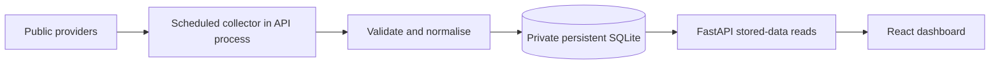

# Architecture

## Boundaries

React never scrapes providers. HTTP reads never trigger collection or wait for its network calls. The collector and request handlers share storage, not an upstream request path. Use short database transactions after complete validation, keeping HTTP waits outside transactions. Scope failures to a provider's collection group; commit unrelated groups independently.

One data-driven screen owns canonical panel data and shared selectors/formatters. Cards reference their current/comparison points; charts, tooltips, and accessible tables use those same points. Keep fixtures in tests. Do not create a second production reference screen or a fixture-mode deployment.

## Collector and UI

Start one cancellable scheduled `asyncio` task in FastAPI's lifespan, with exactly one API worker/instance. Fixed jobs and a due-time check suffice; no scheduler framework or persistent job queue is currently justified. Isolate jobs, prevent overlaps per group, persist run outcomes, coalesce missed intervals after restart, and respect cooldowns from the last attempt. A slow provider must not cancel other jobs or block request handling.

Use HTTPX for bounded async HTTP, explicit connect/read timeouts, and limited backoff on transient failures/429. Do not bypass 403s or certificate verification. Collect permitted market data at most once/minute; check monthly macro releases daily and annual WDI/IMF series weekly. Frequencies are configuration, subject to source-specific permission and feasibility. Store last-valid data in SQLite; conditional upstream requests are optional when supported.

The browser polls the stored-data endpoint once/minute while visible, with abortable requests and no overlapping polls. Initial loading reserves panel/chart geometry. A browser/API failure retains already loaded data with a separate connection-error state; upstream failures are returned as panel states. Update freshness from collection outcomes and release expectations, not from a recent fetch alone. Use publication calendars/grace periods once each source is verified; until then report freshness assessment as unknown rather than fabricating an overdue date.

## Database and dependency budget

| Structure/dependency | Decision and reason |
| --- | --- |
| `observations` | Necessary: one latest-valid record per series/reporting period, decimal value, provenance, and provider status/notes. Historical periods satisfy assignment history. A full archive of every revision is not required. |
| `collection_runs` | Necessary: per-group attempts, successful retrieval/validation time, and failure category, so stale status survives restarts. Bound/clean old diagnostics. |
| `users`, `sessions`, `refresh_tokens` | Implemented for the selected session contract. Session rows supply immediate revocation; active/pending/retired token digests support delivery-confirmed rotation. No plaintext token cache. |
| Schema version | Use ordered SQL migrations with SQLite `PRAGMA user_version`; no migration-history table/framework is needed for this small database. |
| Series definitions and source configuration | Versioned application configuration, not separate mutable `sources`/`series` tables. Preserve period and methodology semantics there; use different series IDs for incompatible bases. |
| Raw snapshot, transformation, card, chart, and table tables | Omit. Source URLs, dataset metadata, response hashes, provider notes, and versioned transforms suffice initially. Keep raw bodies only in ignored diagnostic output unless a later source demonstrates a retention need. |
| Probe dependencies | Historical probes still use only the Python standard library. Application dependencies are locked separately in `uv.lock` and `frontend/package-lock.json`. |
| First backend slice | FastAPI/Pydantic, Uvicorn, HTTPX; `sqlite3` and `asyncio` from standard library. Direct parameterized SQL, no ORM/Redis/Celery/APScheduler. |
| First frontend slice | React, TypeScript, Vite, scoped CSS, Recharts for the required bar/line/stacked chart types. A single fetch/polling hook suffices initially; defer routing/query-state libraries until demonstrated need. |
| Authentication dependencies | PyJWT, Argon2 and python-dotenv are now authorised/implemented. Initial refresh tokens have 256 random bits; successors use a dedicated HMAC key plus the predecessor secret. Only SHA-256 digests persist. Domain setup gates production verification. |
| PDF/HTML parsing | Defer until a validated extractor for a chosen source needs it. Downloading a PDF does not justify installing several parsers. |

The historical proof remains disposable. The application uses `backend/migrations/001_initial.sql`, applied transactionally with `PRAGMA user_version`. SQLite's default journal is sufficient for this low-write assignment. Connections require an existing file; readiness cannot silently create a replacement database. The data directory is owner-only (0700), the database 0600, and the API has no static file/database route. Provider corrections replace a period's valid record after validation; no user-visible revision archive is promised.

Application code lives in `backend/app/` and `frontend/src/`. Test-only dependencies are pytest/Ruff and Vitest/Playwright/Prettier; no ORM, scheduler, query cache, router or state framework is introduced. The chart is lazy-loaded after sign-in. Fonts are self-hosted with OFL licences. Auth, protected reads, validation and failures are covered by the verification matrix.

GDP input defaults to the 12 years ending in the previous UTC year; explicit start/end overrides and a 2–50-year reporting window are supported. The displayed window is shared across both series; absent requested periods stay null instead of silently moving a card to another year. Both countries and their metadata form one WDI collection group. Validation completes before a short commit. Non-null corrections replace prior data; provider omissions retain existing values with their original point provenance and a visible retained/stale flag. A new gap stays null. Collection lateness (twice the configured interval), source failure and unknown economic-release freshness are distinct concepts.

The supervisor starts in FastAPI lifespan, coalesces missed jobs, prevents overlap, records cancellation/restart interruption and retries after failure on the shorter of one hour or the configured interval. Each request has a timeout, byte limit and bounded retry budget; the group also has an overall deadline. Reads never enqueue work. Process supervision belongs to the host; `/healthz` checks storage and task liveness without calling providers. Run exactly one worker/replica with this scheduler/SQLite arrangement.

## Planned hosting, not deployed hosting

Frontend: Cloudflare Pages. API: one paid Render instance with an attached persistent disk. SQLite, its sidecars, backups, and collector state stay under that disk's mount path, outside anything the frontend/static server can serve. Restrict directories to the service identity and database files to owner access. SQLite has no TCP listener, so a database bind address/proxy/firewall port is unnecessary; document the absence of network exposure. API binds its HTTP port, not a database port.

Use private daily consistent SQLite backups and a private off-host copy, then verify restore. A disk snapshot is not a substitute for a consistent database backup. Disk mounting, non-public file access, restart/redeploy persistence, backups, and restore remain deployment acceptance checks, not local-proof claims.

[Render disks](https://render.com/docs/disks) support the intended single instance but prevent zero-downtime deployment and cannot be shared with a separate cron service. Run collection inside the API environment. Separate static and API environments meet the brief; do not colocate them to solve cookie issues.

Authentication requires `https://dashboard.<controlled-domain>` on Pages and `https://api.<controlled-domain>` on Render: separate origins/hosts, one HTTPS site. Required setup and a same-origin proxy alternative are in `contracts.md`. No domain, deployed origins, provider account access, or cloud source egress has been verified.

The production API start command must bind the host-provided HTTP port (for Render: `--host 0.0.0.0 --port "$PORT" --workers 1`), unlike the local loopback command. No database port is opened. Configure the static build's HTTPS API base URL and production secrets/origins explicitly before deploying.

Only a concrete limitation should trigger PostgreSQL: multiple API replicas, separate collector machines requiring shared storage, unsupported persistent-disk semantics, or measured write contention. A move would use a private connection boundary and blocked public DB ingress; a public HTTP proxy would not provide database isolation.
